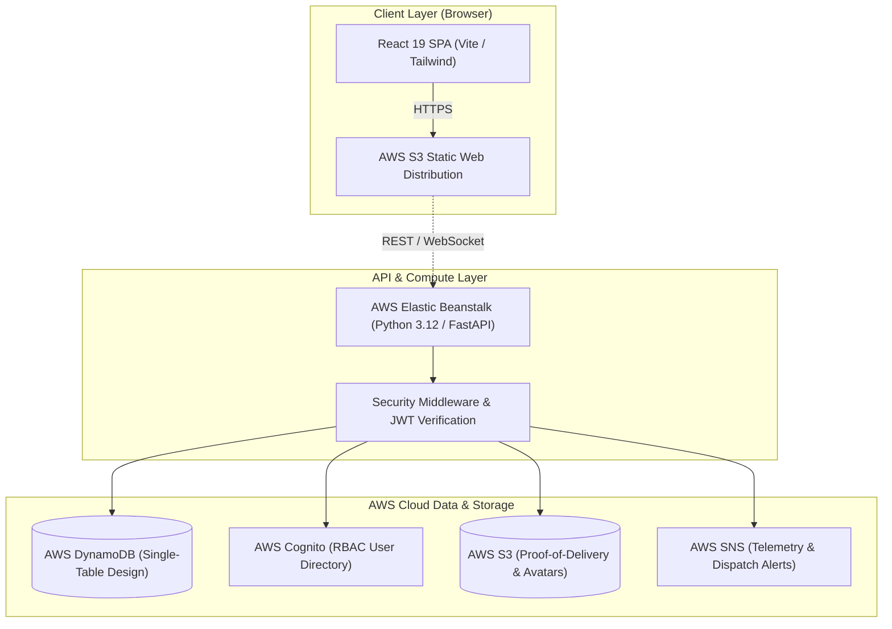

# AeroDispatch — Cloud-Native Logistics & Telemetry Platform

<p align="center">
  
  
  
  
  
  
</p>

---

## 🌐 Live Production Deployment

| Service | Environment | Endpoint URL | Status |
| :--- | :--- | :--- | :--- |
| **Frontend Web App** | AWS S3 Website Hosting | [AeroDispatch Live](http://aerodispatch-web-761112473042.s3-website.ap-northeast-2.amazonaws.com) | `🟢 Operational` |
| **Backend API** | AWS Elastic Beanstalk (AL2023 / Python 3.12) | [API Base](http://aerodispatch-api-live.eba-phcug3cm.ap-northeast-2.elasticbeanstalk.com) | `🟢 Ready` |
| **Interactive API Docs** | FastAPI Swagger UI | [Swagger OpenAPI](http://aerodispatch-api-live.eba-phcug3cm.ap-northeast-2.elasticbeanstalk.com/docs) | `🟢 Live` |
| **Health Probe** | Elastic Beanstalk Health Check | [Health Endpoint](http://aerodispatch-api-live.eba-phcug3cm.ap-northeast-2.elasticbeanstalk.com/health) | `🟢 Healthy` |

---

## 📌 Overview

**AeroDispatch** is an enterprise-grade, cloud-native logistics dispatch, consignment telemetry tracking, and fleet management platform. Designed for high throughput and sub-second response times, the platform combines a modern **React 19 Single Page Application (SPA)** with an asynchronous **Python FastAPI backend**, backed by an **AWS Serverless & Cloud Infrastructure** (DynamoDB Single-Table Design, Cognito User Pools, S3 Proof-of-Delivery, and Elastic Beanstalk).

---

## 🏗️ Architecture & Cloud Infrastructure



---

## ✨ Core Features & Highlights

### 1. Multi-Modal Consignment Booking & Dispatch
- Dynamic service tier selector: **AeroExpress Air**, **Standard Surface Linehaul**, and **Same-Day Priority Courier**.
- Automated volumetric weight and dimensional tare calculations with real-time tariff estimation.
- Cryptographically idempotent order manifestation with dynamic digital Air Waybill (AWB) generation.

### 2. Live Telemetry & Timeline Tracking
- Public tracking gateway supporting instant lookups by **Mobile Number**, **AWB Tracking ID**, or **Internal Order ID**.
- Real-time consignment milestone progression: Booked ➔ Manifested ➔ In-Transit ➔ Out for Delivery ➔ Delivered with digital Proof of Delivery (PoD).

### 3. Fleet & Driver Allocation Engine
- Dispatch control tower with real-time driver availability, operational zone routing, and rating metrics.
- Independent card scroll containment (`overscroll-behavior: contain`) allowing dispatchers to review detailed consignments without bubbling page scroll.
- Direct driver consignment assignment and acceptance/decline telemetry tracking.

### 4. WhatsApp-Grade Profile Avatar System
- High-fidelity interactive profile modal with smooth zoom, rotate, download, and reset capabilities.
- Intelligent client-side image compression converting uploaded photos to crisp, lightweight WebP/PNG formats without dark fills.
- Integrated **"✨ Remove BG"** feature providing one-click background isolation and alpha feathering directly in the client.

### 5. Multi-Tenant Role-Based Access Control (RBAC)
- **Control Tower Admin**: Complete fleet oversight, system metrics, consignment dispatch, and service logs.
- **Field Delivery Driver**: Assigned delivery manifests, navigation routing, and live delivery status updates.
- **Enterprise Merchant / Customer**: Self-service booking, manifest management, and consignment analytics.
- Instant 1-click demo role switching and secure credential authentication via AWS Cognito & Argon2id hashing.

### 6. Adaptive High-Contrast UI
- Seamless toggle between Dark Mode and Light Mode.
- Adaptive dropdown components with soft elevation shadows, crisp typography, and high-visibility status indicators.

---

## 🛠️ Tech Stack

| Domain | Technology |
| :--- | :--- |
| **Frontend** | React 19, Vite, Lucide Icons, Modern CSS3 with Custom Variables, HTML5 Canvas |
| **Backend** | Python 3.12, FastAPI, Uvicorn, Pydantic v2, Argon2id, Boto3 |
| **AWS Cloud Services** | Elastic Beanstalk, DynamoDB, S3, Cognito User Pools, SNS, CloudWatch |
| **DevOps & Tooling** | AWS CLI, Git, Vite Rolldown, Pytest, Node.js |

---

## 🚀 Local Development Setup

### Prerequisites
- **Node.js**: v18.0 or higher
- **Python**: v3.11 or v3.12
- Git

### 1. Clone the Repository
```bash
git clone https://github.com/AnilPrajapati543543/aero-dispatch.git
cd aero-dispatch
```

### 2. Backend Setup (FastAPI)
```bash
cd backend

# Create and activate virtual environment
python -m venv .venv

# Windows:
.venv\Scripts\activate
# macOS/Linux:
# source .venv/bin/activate

# Install dependencies
pip install -r requirements.txt

# Run development server with live reload
uvicorn src.main:app --host 127.0.0.1 --port 8000 --reload
```
* **API Documentation**: `http://127.0.0.1:8000/docs`
* **Health Check**: `http://127.0.0.1:8000/health`

### 3. Frontend Setup (React 19 + Vite)
In a separate terminal:
```bash
cd frontend

# Install packages
npm install

# Start Vite dev server
npm run dev
```
* **Web App URL**: `http://localhost:5173`

---

## 🔐 Credentials & Demo Access

The platform provides pre-configured credentials and 1-click quick-access buttons on the login portal:

| Role | Email | Password | Access Scope |
| :--- | :--- | :--- | :--- |
| **Customer / Merchant** | `customer@aerodispatch.io` | `Customer@123` | Booking, consignment management & tracking |
| **Courier Driver** | `driver@aerodispatch.io` | `Driver@123` | Assigned manifests, delivery acceptance |
| **System Admin** | `admin@aerodispatch.io` | *Direct Admin Code* | Full fleet management & operations |

---

## 📄 License

This project is licensed under the [MIT License](LICENSE).
